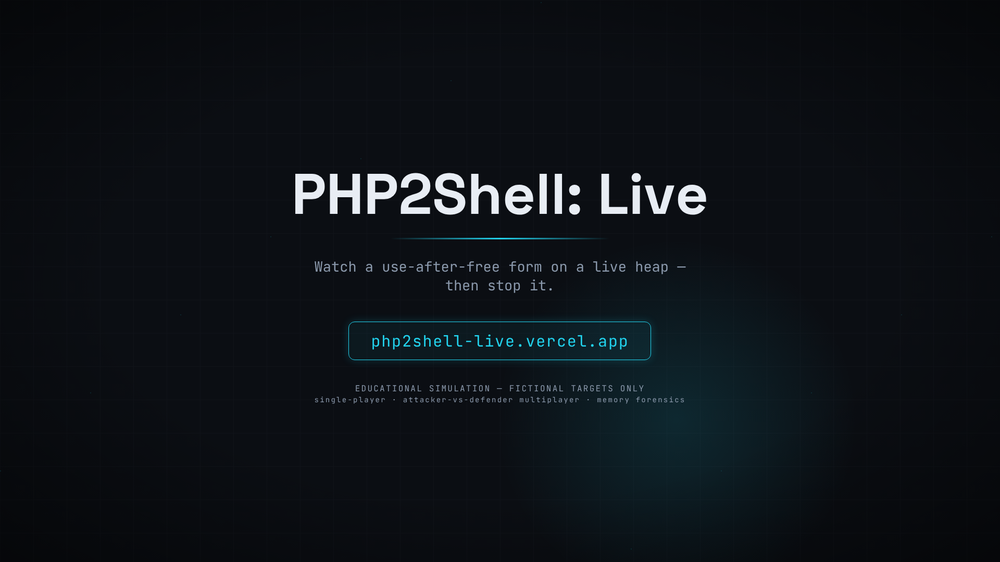
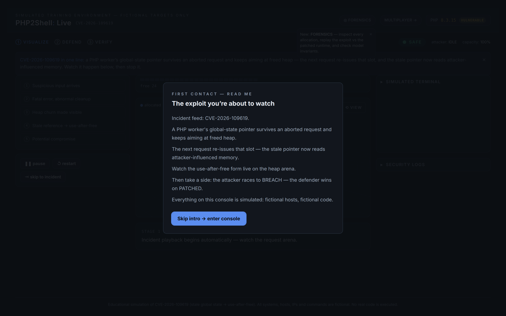
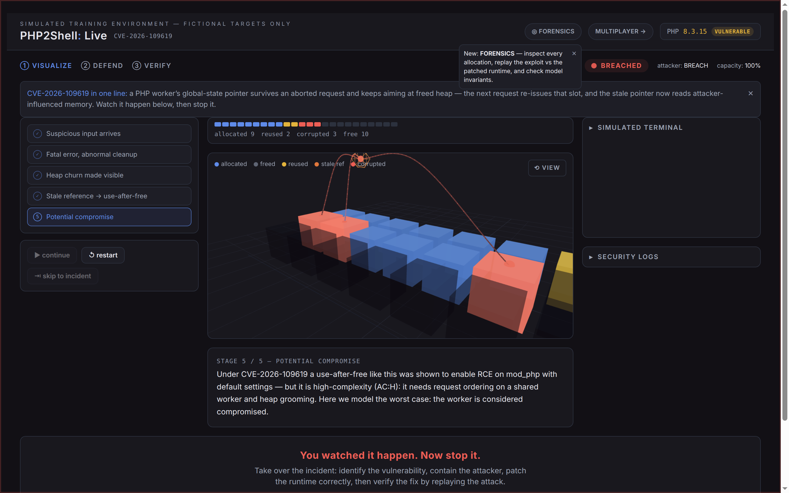
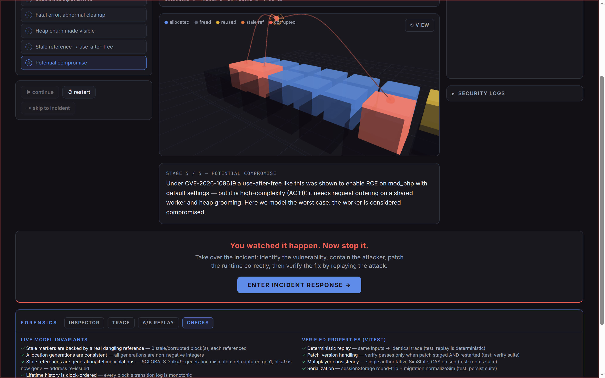
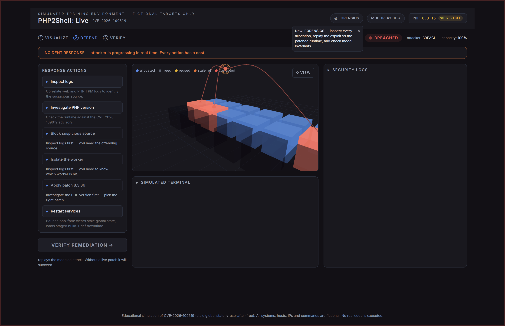
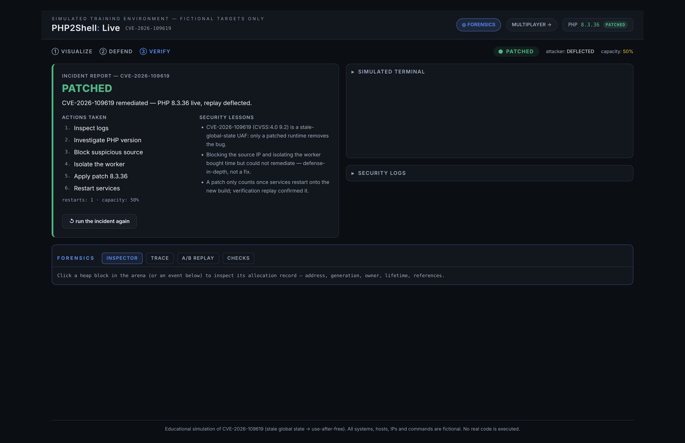
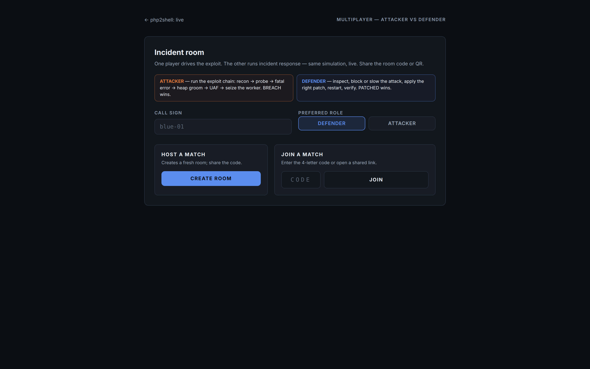

# PHP2Shell: Live

Cybersecurity education through simulated incident-response gameplay.
Next.js 16 · TypeScript · Tailwind CSS 4 · Motion · xterm.js — real-time
attacker-vs-defender multiplayer over WebSockets + Upstash Redis.

> All gameplay is a client-side simulation against fictional targets.
> See `AGENTS.md` for the simulation boundaries and engineering conventions.

## Live demo

https://php2shell-live.vercel.app — first deployment (production domain of
the hobby project; the repo is git-connected so pushes auto-deploy and PRs
get preview deployments).

## Demo video (42 s, silent, caption-led)

[](docs/media/php2shell-live-demo.mp4)

The opening heap strip is a labeled illustration; every product frame is a
real production capture. The full edit plan lives in `storyboard.json`.

### Screenshots

| | |
|---|---|
|  |  |
|  |  |
|  |  |

### Regenerate the video

```bash
cd video
npm install
npm run render   # remotion render src/index.tsx Main out/php2shell-live-demo.mp4 --codec h264 --crf 23
npm run still    # poster frame -> out/poster.png
```

Sources: `storyboard.json` (scene timings/captions), `video/src/` (composition
at 1920x1080, 30 fps). Screenshots are consumed straight from `docs/media/`
via `Config.setPublicDir`; the small `docs/media/crops/` derivatives are
ffmpeg re-crops of the same captures (regenerate with `ffmpeg -i <src> -vf
crop=iw*W:ih*H:iw*X:ih*Y`).

## The game

One continuous journey: **Visualize → Defend → Verify**.

- **Visualize** — auto-played five-stage simulation of CVE-2026-109619
  (stale global state → use-after-free on a shared php-fpm worker) with a
  visible heap, xterm.js terminal, security logs, and playback controls.
- **Defend** — real-time incident response. Actions have prerequisites and
  costs; only a patched + restarted runtime remediates.
- **Verify** — replays the modeled attack and reports PATCHED or explains
  which defense was insufficient.

## Multiplayer (`/play`)

Real-time attacker-vs-defender rooms on top of the same simulation engine:

- Create a room → share the 4-letter code, link, or QR code.
- One player attacks (recon → probe → trigger → groom → UAF → breach), one
  defends; spectators watch when both seats are taken.
- The server validates every action, gates it by role, and serializes state
  with compare-and-set so concurrent moves can't clobber each other.
- Transport: native WebSocket on Vercel Functions (`upgradeWebSocket`) with
  an automatic REST polling fallback; heartbeats drive presence.
- Refresh recovery via sessionStorage identity; a dropped player's seat
  frees up after the presence window.
- Room state lives in an in-memory store locally and Upstash Redis on
  Vercel (`KV_REST_API_URL`/`KV_REST_API_TOKEN`, injected by the Upstash
  integration), so players on different function instances stay in sync.

### Hardening (what the server enforces)

- **Authz** — every mutation requires the room's `playerId` + server-issued
  bearer `token`; role gates reject cross-role actions.
- **Validation** — action payloads are whitelist-checked (`defend`/`attack`
  ids, `verify`, `reset`); unknown payloads are rejected before state
  changes. Call signs are control-char-stripped and capped at 24 chars.
- **Rate limits** — room creation is capped at 20/hour per client IP;
  per-player actions have a 150 ms floor; both via a fixed-window limiter
  that uses Redis when present, memory locally.
- **Isolation** — all state is keyed by room code (`p2s:room:<CODE>`); one
  room's players/actions/snapshots never touch another's.
- **Freshness** — every room API response is `Cache-Control: no-store`;
  sockets live up to `maxDuration = 300`; presence is heartbeat-derived
  (~9 s) and ghosts older than 2 min are pruned on join.
- **Redis consumption** — CAS writes only on mutation; polls read one key;
  heartbeats piggyback on ~5 s touches; rooms expire after 60 min idle.

## Getting started

```bash
nvm use          # Node 24 (see .nvmrc)
npm ci
npm run dev      # http://localhost:3000
```

## Checks

```bash
npm run lint && npm run typecheck && npm test && npm run build
```

CI (`.github/workflows/ci.yml`) runs the same gates on every push and PR.

## Limitations & security boundaries

- **Simulation only** — no real exploit, no shells, no live targets. Heap,
  terminal, and logs are deterministic renderings of CVE-2026-109619, not
  attack tooling.
- **Transport** — WebSockets work only in the Vercel runtime; local dev and
  `next start` automatically use the polling fallback.
- **Scale** — rooms hold ≤8 players, TTL 60 min; a demo tool, not a
  production matchmaking service. Identity is sessionStorage + a room
  token (no accounts).
- **Persistence** — room state is ephemeral (Redis key TTL); nothing is
  logged to a durable database.
- **Known issue** — the `/` dashboard header overflows on ~390px viewports
  (`scrollWidth` 420 vs client 390; the header row's title + chips don't
  wrap). `/play` is clean at the same width.

## Docs

- `AGENTS.md` — architecture, TypeScript standards, component and testing
  conventions, security-simulation boundaries.
- `ENVIRONMENT.md` — toolchain, Devin environment persistence, MCP
  integrations, deploy readiness.
- `.devin/skills/` — project skills for Devin sessions (frontend-design,
  security-simulation, browser-qa, deployment-check).
- `docs/JUDGE_DEMO.md` — 90-second judge-demo script + submission text.
